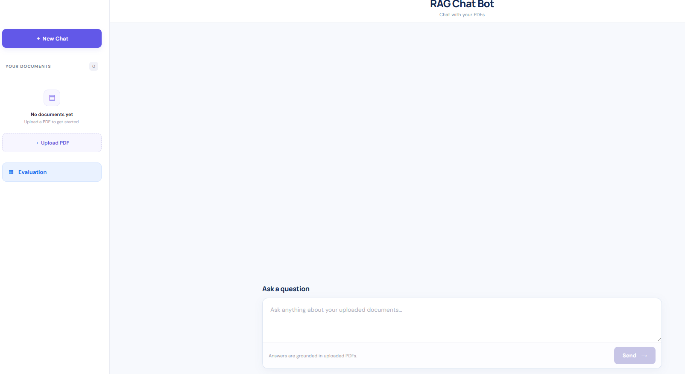
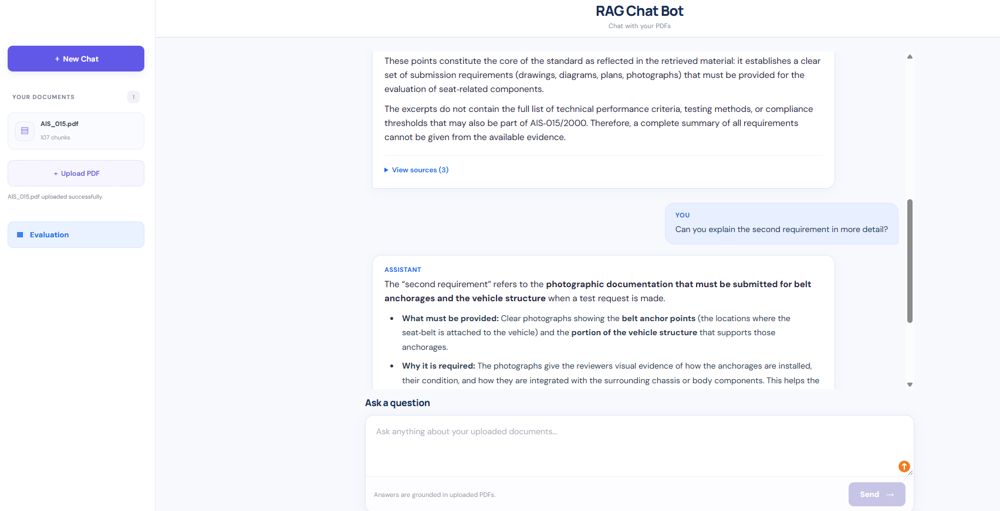

# RAG Chat Bot — RAG Evaluation Workbench

**Chat with your PDFs, inspect supporting evidence, and compare retrieval strategies using reproducible research benchmarks.**

RAG Chat Bot is a full-stack Retrieval-Augmented Generation (RAG) application built with **FastAPI, React, TypeScript, and Python**.

Users can upload PDF documents, ask questions, and continue conversations with follow-up questions. Answers are generated from retrieved document passages, while supporting evidence, PDF filenames, and page numbers are available in expandable source panels.

Beyond document chat, the project evaluates **BM25, TF-IDF, and Semantic retrieval** using two scientific benchmarks: **BEIR SciFact** and **QASPER**.

The application includes a read-only Evaluation panel displaying the recorded benchmark results.

---


## Application Screenshots

### Chatbot Interface



### PDF Question Answering




## Features

- **PDF Question Answering:** Upload PDFs and ask questions about their contents.
- **Conversational Memory:** Ask follow-up questions that refer to earlier messages.
- **Source Transparency:** Expand *View sources* to inspect retrieved passages and PDF page references.
- **Multiple Retrieval Strategies:** BM25, TF-IDF, and Semantic retrieval.
- **Semantic Search:** Uses `all-MiniLM-L6-v2` sentence embeddings.
- **Simple Chat Interface:** Semantic retrieval runs internally without requiring users to choose an algorithm.
- **Automatic Session Management:** Sessions are created automatically when the application opens.
- **Evaluation Dashboard:** View saved SciFact and QASPER results through a closable sidebar panel.
- **Automated Testing:** 61 Python tests passing.

### PDF Upload Limits

| Restriction | Limit |
|---|---|
| File format | PDF |
| Maximum file size | 10 MB per PDF |
| Maximum pages | 50 pages per PDF |
| Maximum documents | 3 PDFs per session |

Text-based PDFs are supported. Scanned or image-only PDFs may not provide extractable text.

---

## Tech Stack

| Component | Technology |
|---|---|
| Frontend | React, TypeScript, Vite, CSS |
| Backend | Python, FastAPI, Uvicorn |
| PDF Processing | pypdf |
| Keyword Retrieval | BM25 |
| Statistical Retrieval | TF-IDF |
| Semantic Retrieval | Sentence Transformers |
| Embedding Model | `all-MiniLM-L6-v2` |
| Answer Generation | Ollama Cloud (`gpt-oss:120b-cloud`) |
| Evaluation Datasets | BEIR SciFact, QASPER |
| Testing | pytest |

---

## System Architecture

```text
                  RAG Chat Bot
                       |
                       v
                React Frontend
                       |
                       v
                  FastAPI API
                       |
          +------------+------------+
          |                         |
          v                         v
     PDF Upload               User Question
          |                         |
          v                         v
   Text Extraction          Conversation History
          |                         |
          v                         |
   Page-aware Chunking              |
          |                         |
          v                         |
   Session Document Store           |
          |                         |
          +------------+------------+
                       |
                       v
                RAG Retrieval
                       |
          +------------+------------+
          |            |            |
          v            v            v
         BM25        TF-IDF       Semantic
                       |
                       v
               Top-3 Passages
                       |
                       v
                  LLM Response
                       |
                       v
               Generated Answer
                       +
               Supporting Sources
```

The chat interface uses Semantic retrieval internally to keep the user experience simple.

The offline evaluation workflows separately compare all three retrieval methods.

---

## Evaluation Results

The project evaluates both retrieval quality and generated-answer quality.

### 1. BEIR SciFact — Retrieval Evaluation

Retrieval methods were compared using:

- **300 evaluation queries**
- **5,183 scientific documents**
- **Top-k = 5**

The following metrics were calculated:

- **Precision@5:** Proportion of retrieved documents that are relevant.
- **Recall@5:** Proportion of relevant documents found within the top five results.
- **nDCG@5:** Ranking quality, accounting for the positions of relevant documents.
- **MRR@5:** How early the first relevant document appears.

#### Results

| Retrieval Method | Precision@5 | Recall@5 | nDCG@5 | MRR@5 |
|---|---:|---:|---:|---:|
| BM25 | 0.1567 | 0.7243 | **0.6431** | **0.6247** |
| TF-IDF | 0.1413 | 0.6466 | 0.5547 | 0.5354 |
| Semantic | **0.1640** | **0.7379** | 0.6293 | 0.5997 |

#### Findings

Semantic retrieval achieved the highest Precision@5 and Recall@5.

BM25 achieved the highest nDCG@5 and MRR@5, indicating stronger ranking performance according to those metrics.

These findings show that retrieval performance depends on the evaluation metric and task.

---

### 2. QASPER — Answer Quality Evaluation

The QASPER benchmark evaluates generated answers to questions about scientific papers.

The experiment used:

- **50 eligible questions**
- The **same questions** for all three retrieval methods
- **Top-k = 3** retrieved passages
- **150 generated answers** in total

Three aspects were evaluated:

**Token F1**

Measures token overlap between generated answers and reference answers.

**Faithfulness**

Uses an LLM-based judge to estimate whether generated claims are supported by the retrieved evidence.

**Abstention Rate**

Measures how frequently the chatbot responds with *"Insufficient evidence"* instead of attempting an unsupported answer.

#### Results

| Retrieval Method | Mean Token F1 | Mean Faithfulness | Abstentions | Abstention Rate |
|---|---:|---:|---:|---:|
| BM25 | 0.1100 | **0.9370** | 23 / 50 | 46% |
| TF-IDF | 0.1584 | 0.8851 | 21 / 50 | 42% |
| Semantic | **0.1843** | 0.8509 | **14 / 50** | **28%** |

#### Findings

Semantic retrieval achieved the highest Token F1 and the lowest abstention rate in this experiment.

BM25 achieved the highest measured faithfulness among non-abstained answers.

The results illustrate a trade-off between answer coverage, reference-answer overlap, and measured faithfulness.

#### Evaluation Limitations

- Token F1 may penalize valid paraphrases or longer answers.
- Faithfulness is estimated by an LLM judge and does not guarantee factual accuracy or completeness.
- Mean faithfulness is calculated only for non-abstained answers.
- A lower abstention rate does not automatically mean better factual accuracy.
- Results depend on the dataset, evaluation configuration, and selected questions.

The Evaluation panel displays these saved benchmark results. It does not run live evaluations on user-uploaded PDFs.

---

## Installation and Setup

### Prerequisites

- Python 3.12 or newer recommended
- Node.js and npm
- Git
- Ollama Cloud API access and access to the configured model

### 1. Clone the Repository

```bash
git clone https://github.com/YOUR_USERNAME/YOUR_REPOSITORY.git
cd YOUR_REPOSITORY
```

Replace the placeholder URL with your actual GitHub repository URL.

### 2. Set Up the Backend

Create a Python virtual environment:

```bash
python -m venv .venv
```

Activate it.

**Windows Git Bash:**

```bash
source .venv/Scripts/activate
```

**macOS / Linux:**

```bash
source .venv/bin/activate
```

Install Python dependencies:

```bash
pip install -r requirements.txt
```

### 3. Configure Environment Variables

Create a `.env` file in the project root.

Example:

```env
PRIMARY_LLM_PROVIDER=ollama
OLLAMA_API_KEY=your_ollama_api_key_here
OLLAMA_MODEL=gpt-oss:120b-cloud
```

Replace `your_ollama_api_key_here` with your own API key.

**Important:** Never commit API keys or the `.env` file to GitHub.

### 4. Start the Backend

From the project root:

```bash
uvicorn app.main:app --reload
```

The backend runs at:

http://127.0.0.1:8000

FastAPI API documentation:

http://127.0.0.1:8000/docs

### 5. Start the Frontend

Open a second terminal.

Navigate to the frontend:

```bash
cd frontend
```

Install dependencies:

```bash
npm install
```

Start the development server:

```bash
npm run dev
```

Open the URL shown in the terminal, usually:

http://localhost:5173

---

## How to Use

1. Open RAG Chat Bot in your browser.
2. Upload a supported PDF document.
3. Enter a question about the uploaded document.
4. Read the AI-generated answer.
5. Expand **View sources** to inspect supporting document passages.
6. Ask follow-up questions within the same conversation.
7. Click **New Chat** to clear the conversation.
8. Click **Evaluation** in the sidebar to view the benchmark results.
9. Close the Evaluation panel using the **×** button.

Sessions are temporary and created automatically.

Refreshing the browser currently creates a new session, so documents may need to be uploaded again.

---

## Benchmark Workflows

### SciFact

Download the dataset:

```bash
python download_scifact.py
```

Run the retrieval evaluation:

```bash
python evaluate_scifact.py
```

### QASPER

Prepare the QASPER dataset:

```bash
python download_qasper.py
```

Run the QASPER evaluation:

```bash
python evaluate_qasper.py
```

The QASPER evaluation supports BM25, TF-IDF, and Semantic retrieval through its configuration.

Evaluation results are saved as JSON files in the `results/` directory.

Running the answer-quality evaluation requires access to the configured language model and may incur API costs.

---

## Testing

### Backend

Run the automated Python tests:

```bash
python -m pytest -q
```

Latest local test result:

```text
61 passed
```

### Frontend

Navigate to the frontend directory:

```bash
cd frontend
```

Build the application:

```bash
npm run build
```

Check linting:

```bash
npm run lint
```

---

## Project Structure

```text
RAG Evaluation Workbench/
|
|-- app/
|   |-- main.py
|   |-- document_processor.py
|   |-- retriever.py
|   |-- generator.py
|   |-- session_manager.py
|   |-- benchmark.py
|   |-- ...
|
|-- frontend/
|   |-- src/
|   |   |-- App.tsx
|   |   |-- App.css
|   |   |-- index.css
|   |   |-- main.tsx
|   |
|   |-- package.json
|
|-- download_scifact.py
|-- evaluate_scifact.py
|-- download_qasper.py
|-- evaluate_qasper.py
|
|-- test_*.py
|-- requirements.txt
|-- README.md
```

Downloaded benchmark datasets, uploaded PDFs, and local evaluation output files may be stored separately and should not be assumed to be included in the GitHub repository.

---

## Current Limitations

- PDF text extraction works best with text-based PDFs.
- OCR for scanned PDFs is not currently supported.
- Sessions are temporary rather than persistent user accounts.
- Refreshing the browser creates a new session.
- The quality of generated answers depends on retrieved evidence.
- The chatbot can abstain when the available context is insufficient.
- Benchmark results vary by task and evaluation metric.
- The Evaluation panel currently displays fixed benchmark scores.

---

## Future Improvements

The following improvements are planned after the initial GitHub and CV release:

- Load the latest complete benchmark results dynamically instead of hardcoding values.
- Support larger QASPER comparisons, such as 100 questions across all three retrieval methods.
- Export detailed evaluation results to Excel.

---

## Dataset Acknowledgments

This project uses the following research datasets:

- **BEIR / SciFact:** Scientific information retrieval benchmark.
- **QASPER:** Question-answering benchmark based on scientific papers.

The respective dataset licenses and terms should be reviewed before redistributing benchmark data.

---

## Project Goal

This project was developed to explore practical Retrieval-Augmented Generation and the evaluation of different retrieval strategies.

It combines a user-facing PDF question-answering application with reproducible experiments measuring retrieval relevance, answer overlap, faithfulness, and abstention behavior.

The goal is not only to generate answers from documents, but also to understand how retrieval choices affect the quality and reliability of those answers.
